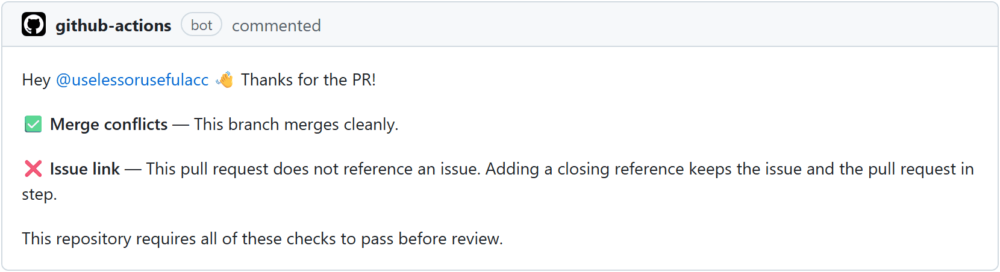

<p align="center">
  
</p>
<p align="center"><b>Repository-owned configuration. Durable, explainable decisions. No server to host.</b></p>
<p align="center"><a href="https://github.com/hiero-hackers/sdk-automations/actions/workflows/ci.yml"></a> <a href="https://github.com/hiero-hackers/sdk-automations/actions/workflows/codeql.yml"></a> <a href="https://scorecard.dev/viewer/?uri=github.com/hiero-hackers/sdk-automations"></a> <a href="https://github.com/hiero-hackers/sdk-automations/releases"></a> <a href="LICENSE"></a> <a href="https://discord.com/invite/hyperledger"></a></p>
<p align="center"><a href="docs/installing.md">Install</a> · <a href="docs/README.md">Docs</a> · <a href="docs/capabilities.md">Capabilities</a> · <a href="CONTRIBUTING.md">Contributing</a> · <a href="SECURITY.md">Security</a></p>

Hiero SDK repositories repeat the same contributor-facing work: triage, pull-request checks,
workflow labels, stalled work, claiming issues. SDK Automations does it from one reviewed
`sdk-automations.yml` on the default branch, as a GitHub Action or a hosted App. It decides one
issue or pull request at a time, writes nothing until a maintainer arms it, and records every
decision with its reason. It is pre-1.0, piloting as an Action on [hiero-hackers/analytics](https://github.com/hiero-hackers/analytics).

<p align="center"></p>

## Capabilities

| Capability | What a repository gets |
|---|---|
| `triageQueue` | new issues labelled for triage, with an optional welcome and a lock until triaged |
| `prDashboard` | one comment per pull request saying what stops it being ready to review, and optionally a label |
| `inactivity` | a reminder on stalled assignments and pull requests, then, where enabled, their release |
| `assignment` | contributors claim and release issues with a comment |
| `configReport` | a comment on any pull request that changes `sdk-automations.yml`, saying what it would mean |

Every capability is off until enabled. [What each one reads and may write →](docs/capabilities.md)

## Quick start

Add the workflow from [`docs/installing.md`](docs/installing.md), then merge this file:

```yaml
# sdk-automations.yml — observe records what would happen; dry-run also names each change
mode: observe

capabilities:
  triageQueue:
    enabled: true
  configReport:
    enabled: true
```

Each run's job summary lists its decisions. Nothing changes on GitHub until the file says `active`
and the workflow sets `arm-writes: "true"`.

## Safe by construction

- The configuration is read from the default branch; a run never checks out a contributor's code.
- Every outcome passes one safety ladder; a refusal carries a [code](docs/troubleshooting.md) that explains it.
- A write is re-checked against a live read, then confirmed by reading GitHub back.
- A release or a close comes only after a public warning and its grace period.

## Learn more

- [Documentation](docs/README.md) — quickstart, every configuration key, every refusal code.
- [Architecture](design/architecture.md), starting from [one label's trace](design/trace.md).
- [Contributing](CONTRIBUTING.md) — setup, the house rules, and [good first issues](https://github.com/hiero-hackers/sdk-automations/issues?q=is%3Aissue+is%3Aopen+label%3A%22good+first+issue%22).

---
Apache-2.0 · [Code of Conduct](CODE_OF_CONDUCT.md) · [AI policy](AI_POLICY.md) · DCO sign-off required
