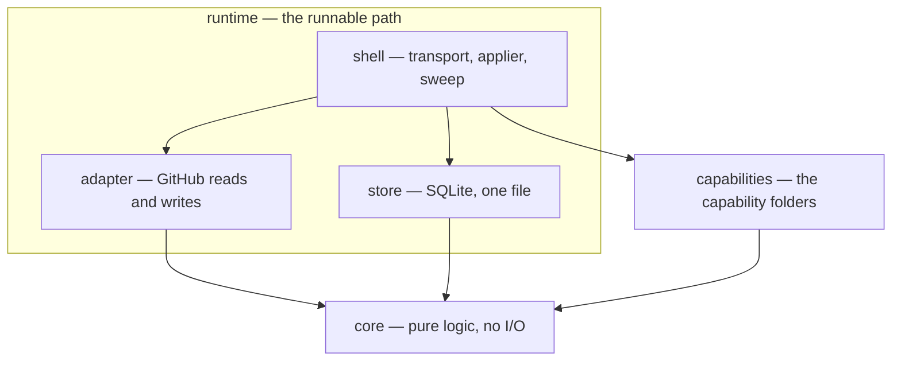
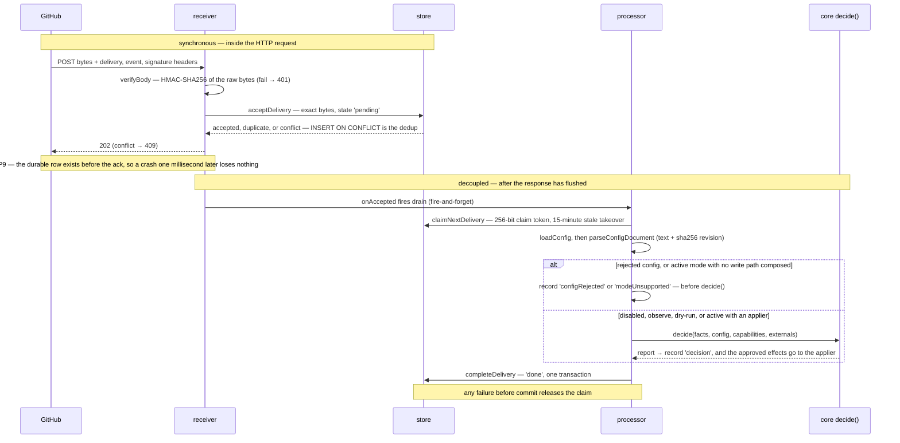

# Architecture

> The map. [`trace.md`](trace.md) is the route — one label from GitHub's POST to GitHub's API call —
> and it is the page to read first; this one says what the pieces are and which rule holds each edge
> in place. The italic line under each drawing names the code or test that falsifies it. Why:
> [`constraints.md`](constraints.md). Vocabulary: [`trace.md`](trace.md) §"What each noun is, once".

## 1. Three packages, and the rules between them

Three more sit under `packages/dev/` and never ship: `checks` (repository invariants), `lab` (GitHub
experiments) and `testkit` (fixtures). Store, shell and adapter are DIRECTORIES of `runtime` rather
than packages, and the layer policy did not change when they were filed that way (G4). The rules, as
`.dependency-cruiser.cjs` states them:

| Rule | What it forbids |
|---|---|
| `no-circular` | any cycle — a cycle makes the table unreadable in either direction |
| `core-imports-no-internal-package` | core reaching any workspace neighbour; its TESTS may reach the testkit |
| `core-and-capabilities-stay-pure` | sockets, files and timers in core and capabilities; `node:crypto` is the one argued exception |
| `store-imports-core-only`, `adapter-imports-core-only` | either one reaching the other, the shell, or a capability |
| `shell-imports-core-store-capabilities-adapter` | the shell reaching a development package; composing capabilities is legitimate because the shell decides nothing (D93) |
| `adapter-imported-at-shell-main-only` | credentials entering anywhere but the composition root |
| `testkit-is-test-only`, `testkit-imports-no-internal-package`, `production-imports-no-checks-or-lab` | shipping code importing the testkit, the checks or the lab; the testkit importing anything |
| `no-import-past-the-barrel`, `not-to-unresolvable` | reaching past a barrel, and the named subpath that would resolve to nothing at all |

*Enforced by `packages/dev/checks/test/architecture.test.ts`, which cruises the real tree with these
rules and a deliberately-violating fixture tree to prove they still fire.*

Three directions hold inside those packages. The shell's directories are the boxes of its drawing
(D172):

| Directory | What it owns |
|---|---|
| `compose/` | the environment read into one record, the live seams, and the start |
| `inbound/` | the webhook lane: the receiver, and the delivery it claims and completes |
| `sweep/` | the sweep lane: one firing's budgets and the driver |
| `decide/` | the one box both lanes call — the schedule row, decide one item, apply, write the rows |
| `apply/` | the applier as a loop over a five-row table, one module per operation below it |
| `jobs/` | the tick's four named jobs, and the shutdown order |
| `observe/` | the read-only commands |
| `log.ts`, `paths.ts`, `effects.ts` | the vocabulary every directory above may name |

Core's are an AUDIENCE (D175):

| Directory | Who arrives there |
|---|---|
| `catalogue.ts` | both audiences: the closed vocabulary — refs, facts, resolvers, operations, comment kinds |
| `capability/` | an author: declaration, settings, facts, producers, boundary, factory, guards |
| `author/` | an author, at the door: `index.ts` is the named surface a capability folder imports (`@hiero-hackers/automation-core/author`), `testing.ts` the fixture harness its tests import, and nothing that ships may name the second |
| `intents/` | an effect once decided: the intent, the platform's managed comment, one module per operation |
| `config/`, `workflow/`, `safety/`, `github/` | what the repository asked for and the spec it is read against, the states, the write rules, what we measured of GitHub |
| `engine/` | the composition — normalize, call, screen, gate |
| `report/` | what happened, and who must act |

The adapter's are a JOB (D176):

| Directory | What it does |
|---|---|
| `client/` | talks to GitHub: the contract, the credential chain, the admission gate, the confirmed endpoint shapes, the send |
| `reads/` | reads it: the configuration, the sweep's facts, the resolvers, the live externals |
| `writes/` | changes it: the send-and-classify, the read-back, the request table — one row per verb |

Each of the three keeps the rules its shape carries, read off the imports (D212); the ranks each
directory once held were fence, and the package-level cruiser rules above hold the layers.

| Lock | The rule it states | Enforced by |
|---|---|---|
| shell | `apply/actions.ts` alone names the fold's five states, and `decide/item.ts` alone calls the applier | `packages/dev/checks/test/shell-layering.test.ts` |
| core | `intents/` never names `capability/`, so the check that an intent names the capability that returned it lives in `packages/core/src/engine/invoke.ts`, where intents are collected; nothing below the engine names `engine/` or `report/` | `packages/dev/checks/test/core-layering.test.ts` |
| adapter | the client names neither the reads nor the writes, which is why the admission gate reads the confirmed shapes from `packages/runtime/src/adapter/client/endpoints.ts` and never from the writes; nothing inside names the barrel | `packages/dev/checks/test/adapter-layering.test.ts` |

*Each lock reads every import under its own directory and proves each of its rules can fail over
fixture text.*

## 2. One item is the unit of decision

Everything narrows to this. A producer builds one fact record about ONE item; `decide()` calls each
enabled capability once per record; a capability returns intents about that item and nothing else.
No cross-item read, no durable capability state, no subject that is not an item — a capability
needing one has found a platform gap to write down, never a workaround ([`trace.md`](trace.md)).

Three values cross into a capability and no more: the facts (positions and meanings, never label
strings), a view of its own settings plus the mapped names, and a handle offering only the resolvers
it declared. A GitHub client, a raw payload, a sibling's settings, the repository mode and a
claimable world are absent BY SHAPE — there is no type to reach for.

*Sources: `packages/core/src/engine/decide.ts`, `packages/core/src/capability/boundary.ts` · leaks
refuted by `packages/capabilities/test/boundary.test.ts`, P3 by `engine-matrix.test.ts` beside it.*

## 3. Two producers, one shape of record

| Producer | Wakes on | Reads |
|---|---|---|
| webhook (`issues`, `issue_comment`, `pull_request`) | GitHub telling us something | the projection, `readiness`, `actor`, `author` |
| sweep | a due schedule row — nobody told us anything | every group the endpoint-permission matrix has confirmed, one record per open item |

The registry in `packages/core/src/capability/producers.ts`, read off the group modules in
`capability/groups/`, is the promise: a capability declaring a
need no producer of its trigger reads does not boot. The record is judged again on the day — a group
that failed to read, or that the matrix has not confirmed, arrives `"unread"` and `decide()` skips
the capability with `factsUnread`, so it never branches on what woke the platform.

*Contract: [`contracts/facts.md`](contracts/facts.md), generated from the registry ·
the sweep's own reads and their confirmation status: [`guides/sweep.md`](guides/sweep.md).*

## 4. One delivery, in time

Every rejection fails closed and still completes, so a redelivery decides nothing a second time.
`disabled` is deliberately not intercepted: it runs through `decide()` and the `modeDisabled` gate
refuses each intent, which is why it sits with `observe` and `dry-run` rather than with `active`. The
sweep reaches `decide()` through this same path — mode gate, applier, journal and recovery are all
this lane's.

*Sources: `packages/runtime/src/shell/inbound/receiver.ts`, `inbound/deliveries.ts`,
`decide/item.ts`, `sweep/sweep.ts` — pinned end to end by
`packages/runtime/test/shell/compose/shell.test.ts`. The exhaustive rejection-code table is
[`contracts/config-schema.md`](contracts/config-schema.md); it is deliberately not copied here.*

## 5. Safety, and the path a destructive act takes

An intent passes the screen (its own capability, a declared operation, its own item, a legal
transition), then the world is DERIVED from the facts rather than asserted, then the ladder judges
it: kill switch, precondition, gate policy, then the general rules in a fixed order. Precedence is
contract, not style — [`contracts/safety.md`](contracts/safety.md) holds both vocabularies and the
order, and the drift test freezes them.

A `clockTriggeredDestructive` act is refused at the general gate on purpose: it goes through grace
instead. On first sight the platform approves its OWN warning comment and the act waits; the applier
records the warning when it lands; a later occasion is judged against that record — grace elapsed, no
qualifying activity — and the notice follows the act ([`guides/grace.md`](guides/grace.md)).

## 6. Store — five tables, five questions

One file, two modules over one connection: `inbox.ts` is the delivery queue, whose rows move state
in place; `ledger.ts` is appended and folded, and holds the leases and the schedule beside the facts
(D164). It never reads the clock and owns no policy: every timestamp, retention window and lease
duration is the caller's, and a timestamp that is not exactly `Date.toISOString()` throws rather than
misorder silently (`packages/runtime/src/store/guards.ts`). The payload is opaque bytes here.

| Table | The question it answers |
|---|---|
| `seen_delivery` | is this delivery durable, claimed, done, or dead-lettered? |
| `effect_fact` | what has been sent, landed, refused or promised for this effect? |
| `decision` | what did each pass decide about this item, and why? |
| `effect_claim` | who holds this effect's lease right now? |
| `schedule` | what clock-triggered work is due now? |

*Source: `packages/runtime/src/store/schema.ts` — schema version 1, one migration, no history before
launch (D165); drift rejected by the fingerprint D110 established.*

## 7. What is not built

Active mode runs only where writes are armed. The hosted shell arms them when composed with the
App's identity as well as its credentials, and otherwise records `modeUnsupported`; the Action arms
them with `arm-writes: "true"`, and otherwise decides `active` as `dry-run`. Every read and write
with no cited row in [`findings/endpoint-permission-matrix.md`](findings/endpoint-permission-matrix.md)
— two resolvers, four operations, three of the sweep's facts — is implemented and refuses at the
send. Config schema migration is unbuilt: the live and local reads share today's schema
deliberately. Nothing enumerates what an installation covers, so a repository that has never
delivered is one this process has never heard of (D169). Everything else absent here is an open question in
[`constraints.md`](constraints.md), deliberately not drawn.
